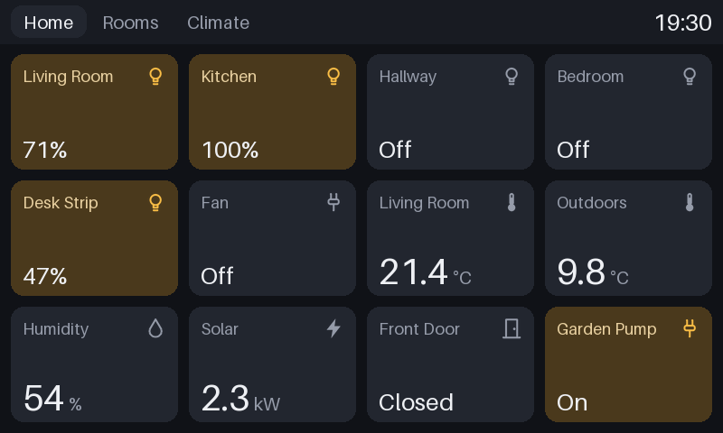
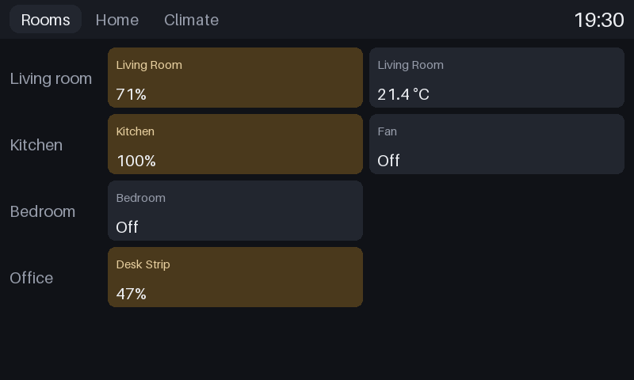
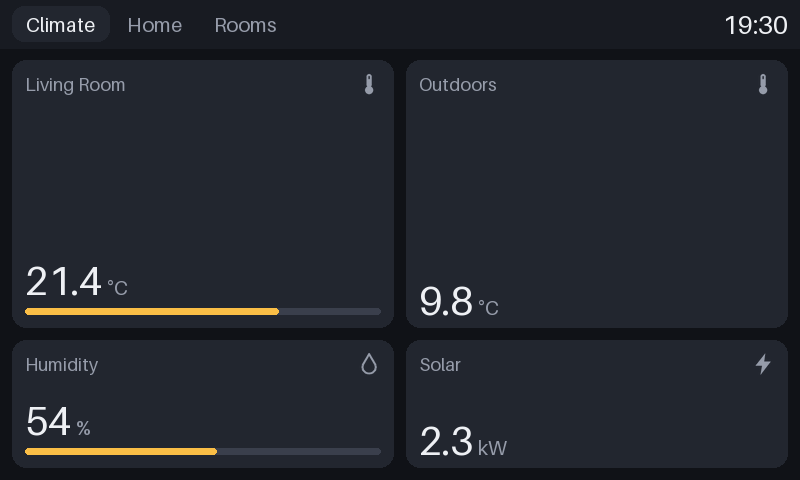

# Juggle HA Control Panel

A [Juggle OS](https://github.com/EarthstormSoftware/juggle-os) app for a Raspberry Pi with the official 7" Touch
Display: a panel on the wall showing Home Assistant's lights and sensors, controlled by touch. Its web page is where
it's set up: the Home Assistant connection, what the screen shows, and the screen's own settings.

It's built on [App Base](https://github.com/EarthstormSoftware/app-base), from
[Juggle Hello](https://github.com/EarthstormSoftware/juggle-hello). The design and the steps are in
[docs/roadmap.md](docs/roadmap.md).

**Status:** working, and running on the author's Pi. Not yet versioned 1.0: the pages and settings may still
change.



## What it does

- **Tiles** for Home Assistant's lights, switches, blinds, sensors, binary sensors and the weather. Tap a light or
  switch to toggle it; **long press** a light for its brightness, warmth, colour and effect, or a sensor for its
  history.
- **Pages**, swiped or chosen in the bar, each laid out as a grid of tiles (sizes from 1x1 to 4x1 and 2x2) or as a row
  for each room.
- A sensor can show its value, a gauge, a graph of its history, or the weather today or tomorrow. Icons are chosen
  from the entity's kind, or by you.
- The screen goes dark after a time you choose and wakes on a touch; its brightness and rotation are settings too.
- All of it, and the Home Assistant address and token, is set on the app's web page at `http://<name>.local`, saved
  on the Pi (`/data/app-state`), never in this repository.

| Rooms | Climate |
|---|---|
|  |  |

These screenshots are drawn from made-up Home Assistant states by `docs/sample/render_sample.py`, using the panel's
own drawing code. A portrait screen is supported too (`docs/sample/home-portrait.png`).

## What it needs

A Pi running Juggle OS with the official 7" Touch Display, and Home Assistant on the same network with a long-lived
access token (your profile in Home Assistant, Security).

## Deploying it

On Windows, with the Pi set up by `juggle flash` (so SSH works with your key):

```powershell
.\deploy.ps1 <name>
```

Then its page is at `http://<name>.local`. Once it's running, `.\deploy.ps1 <name> -WiFi` sends a new version to the
app itself, without SSH.

## Tests

`py -m pytest` (Python 3.11 or later).

## Licence

MIT. See [LICENSE](LICENSE). Microdot is MIT too: see [THIRD-PARTY-NOTICES.md](THIRD-PARTY-NOTICES.md).
